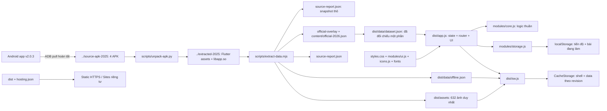
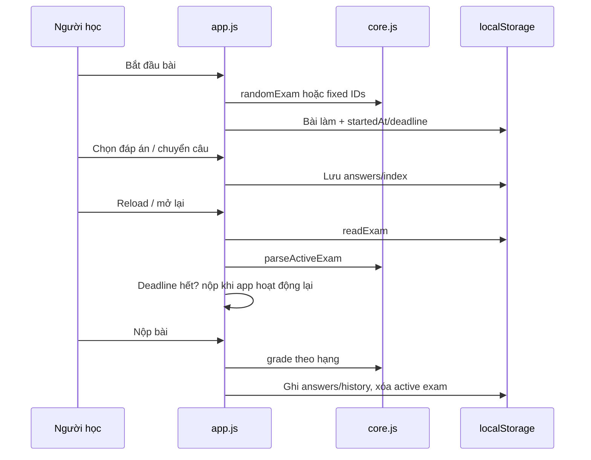

# Bản đồ đầy đủ GPLX2026

Checkout `E:\CODE\GPLX\gplx2026-pwa`, remote GPLX2026. Sibling `gplx-pwa` là dự án GPLX trước; không sửa/lấy nhầm nguồn. Chạy Git/npm trong checkout này, không tạo Git ở workspace root. Đọc AGENTS, VALIDATION, ROADMAP và git status trước khi làm.

## Kiến trúc

## Cây file / trách nhiệm

| File/thư mục | Trách nhiệm |
| --- | --- |
| `dist/index.html` | Shell semantic, desktop/mobile nav, topbar, hạng, main, dialogs, toast, meta/font |
| `dist/styles.css` | Token, dashboard, study/exam/results/signs/handbook, responsive |
| `dist/themes.css` | Dark palette/trạng thái, icon toggle, màu canvas/header/bottom/safe-area |
| `dist/theme-init.js` | Bootstrap trước CSS, lưu theme riêng, meta/color-scheme, toggle một chạm và sync tab/system |
| `dist/app.js` | State/router/render/event, timer, export/import, settings, worker messages |
| `dist/modules/core.js` | normalize/getLicense/poolFor/isCritical/randomExam/grade/filterQuestions/statistics/createProgress/parseProgress/parseActiveExam |
| `dist/modules/storage.js` | readProgress/readExam/writeProgress/writeExam; xử lý storage blocked/quota |
| `dist/modules/ui.js` | escape, dateLabel/dayKey theo Asia/Ho_Chi_Minh, durationLabel, progressBar |
| `dist/modules/chrome.js` | createScrollTracker/setupAutoHideBars: hướng cuộn, rAF, bounce clamp, inert/focus, đo header |
| `dist/modules/install.js` | setupInstall: native beforeinstallprompt/userChoice/appinstalled/standalone và nút header |
| `dist/modules/icons.js` | 35 Lucide SVG vendored, không CDN runtime |
| `dist/sw.js` | Install/activate/fetch/message; precache shell/font, tải ảnh theo lô, marker/revision |
| `dist/data/dataset.json` | Snapshot chuẩn hóa; không sửa tay |
| `dist/data/offline.json` | Revision, bytes và 633 URL gồm dataset + 632 ảnh |
| `dist/assets/` | Ảnh nguồn nguyên byte, gộp duplicate theo SHA-256 |
| `dist/fonts/` | Be Vietnam Pro 4 weight, 12 WOFF2, CSS/manifest/OFL |
| `dist/icons/`, `dist/manifest.webmanifest` | Logo road tự tạo, PNG 192/512, PWA scope/start_url tương đối |
| `scripts/unpack-apk.py` | Giải nén có kiểm tra đường dẫn, output ngoài Git |
| `scripts/extract-data.mjs` | Native hash/key check → CBC → SQLite integrity → giải thích → JSON/ảnh/manifest/report |
| `scripts/vendor-ui.mjs` | Lấy font/icon nguồn chính thức; Lucide pin commit |
| `scripts/compare-data.mjs` | So sánh dataset trước theo ID/NFC/khoảng trắng → comparison-report.json |
| `scripts/serve.mjs` | 127.0.0.1:4174, MIME, traversal guard, no-cache |
| `scripts/check-http.mjs` | Tải mọi file dist + root, status/body/MIME |
| `scripts/check-deploy.mjs` | Scan cả file bị ignore: archive/raw/secrets/symlink/per-file 25MiB |
| `tests/core.test.mjs` | Data, pools, random/grade, import/restore, storage, manifest |
| `tests/service-worker.test.mjs` | In-memory Node VM contract; không phải browser thật |
| `tests/chrome.test.mjs` | Scroll/idle/đổi hướng và install lifecycle với EventTarget giả lập, không phải Chrome thật |
| `tests/theme.test.mjs` | 6 nhóm theme: bootstrap/toggle/storage/system/tab/meta/contrast, Node VM giả lập |
| `source-report.json` | Hash/count/pool/fixedSummary **thô trước overlay**, B592 |
| `content/official-2026.json`, `scripts/official-overlay.mjs` | Nguồn/hash/ID/quota/before-after; applyOfficialCorrections; runtime B600/60 |
| `scripts/update-official.mjs`, `scripts/audit-official.py`, `official-audit-report.json` | Áp overlay/revision offline; so sánh PDF read-only; báo cáo 600 đáp án/ứng viên chữ còn lại |
| `dist/modules/offline.js`, `tests/offline.test.mjs` | createOfflineDownload/activeWorker, consent/restore/message revision; 5 nhóm lifecycle giả lập |
| `tests/official.test.mjs`, `OFFICIAL_AUDIT.md`, `OFFLINE.md` | Reproduction/guard patch, phạm vi xác minh và tải nền |
| `comparison-report.json` | Hash hai dataset và ID khác theo trường |
| `.openai/hosting.json` | Site ID GPLX2026 và static.directory=dist, không chứa token |
| `licenses/`, `THIRD_PARTY.md` | Giấy phép/provenance; không gán license mở cho dữ liệu Android |

## Route / hàm / dữ liệu

| Route | Luồng chính | Dữ liệu/params |
| --- | --- | --- |
| #home | renderHome, continue-study, updateOfflineUI | Pool hạng, stats, mục tiêu ngày VN, resume bài làm |
| #learn | rebuildStudy → renderStudy → questionCard/questionNavigator | scope=all/license, topic, q, question; trạng thái all/new |
| #critical/#wrong/#saved | Chung màn học + filterQuestions | Critical theo hạng; wrong gồm selected=0; bookmarks |
| #signs | renderSigns, sign-detail, more-signs | Active signs, q/category, 32 mục mỗi lượt |
| #exams | renderExamSetup → beginExam → renderActiveExam → finishExam → renderResult | random/fixed, result=history ID |
| #handbook | renderHandbook, handbook-tab, lesson, hint-image | lesson ID; tab=theory hoặc practical |
| #history | renderHistory → view-history | Full records tối đa 30, vẫn mở sau reload |
| Settings dialog | settingsDialog/exportProgress/parseProgress/clearOffline/reset-progress | Import thay tiến độ; chặn khi active exam; xóa ảnh giữ progress |
| Offline dialog | offlineDialog/updateOfflineUI/downloadOffline | Icon header, consent/dung lượng, progress/ready/retry; không render lại bài đang làm |

`go` push/replace history → `applyRoute` đọc hash → rebuildStudy → renderShell + màn hình. Back/Forward qua hashchange. Search/filter dùng replaceState. Danh sách học giữ snapshot trong một lượt để trả lời đúng hoặc bỏ bookmark không làm nhảy câu; vào lại route mới lọc lại.

## Luồng bài làm / lưu

Keys: `gplx2026-progress-v1`, `gplx2026-active-exam-v1`. Active dùng localStorage để còn sau khi đóng trình duyệt. selected=0 là bỏ trống: correct=false, có trong ôn sai, không tính đã học. Import tính lại correct và lọc ID/option. Export progress gồm history, không gồm active exam; hoàn thành bài trước khi chuyển thiết bị. Mỗi origin/browser giữ bản riêng; chưa có backend hoặc multi-tab lock.

## Cache / cập nhật

Shell `gplx2026-shell-v5` có HTML/CSS/modules/data/fonts/icons cùng theme-init.js/themes.css. HTML tham chiếu app/CSS/theme với `?v=5`, URL thường và version đều precache để tránh worker cũ trả code/CSS cũ khi mở online. Tăng version cần cập nhật HTML/SHELL/HTTP check đồng bộ. Data `gplx2026-data-<revision>` không đổi nếu nội dung không đổi. Manifest đọc từ shell hiện hành để không trộn phiên bản. Tải lô 6; marker `offline-ready` chỉ ghi sau đủ 633 URL. Sai MIME/redirect/network/quota không đánh dấu ready, retry dùng phần đã lưu. Activate chỉ xóa shell GPLX2026 cũ; tải data mới hoàn tất mới xóa data cũ.

Sửa shell phải tăng APP_REVISION; sửa dataset/ảnh dùng extractor + manifest. Thêm module/font phải thêm precache. Không auto-reload khi controllerchange. Private hosting có thể cần mạng để xác thực; chưa kiểm chứng browser/PWA/offline thật.

## Chỉ dẫn tiếp tục

Chi tiết module/hành vi UI shell v2 và việc còn phải QA: [UI_UPDATE.md](UI_UPDATE.md).

Theme một chạm, key gplx2026-theme-v1 và giới hạn màu thanh native của shell v3: [THEME.md](THEME.md).

1. Ưu tiên checklist browser/Android trong VALIDATION/ROADMAP; không coi Node/HTTP là visual pass.
2. Đổi logic ở core + test; UI ở app/styles + worker revision; schema đổi cần migration/import tests.
3. Native build mới kiểm tra decoder/offset/hash/schema; overlay phải từ chối nguồn thay đổi, không ghi đè tùy tiện. source-report và comparison-report là bằng chứng snapshot gốc.
4. Membership/critical/quota CV2262 đã xác minh; cách viết/giải thích/ảnh/mẹo và chuyển cấu trúc 01/03/2027 còn việc ở OFFICIAL_AUDIT/ROADMAP.
5. Cập nhật map/data/validation/timeline sau chặng; kiểm tra remote trước push, không force.

## Luồng tải nền và màu native — shell v4

Header icon → offlineDialog xác nhận → createOfflineDownload nhớ consent → activeWorker đợi activated → worker download-offline theo revision → lô6 ảnh → marker đủ633 → icon tick. Progress chỉ cập nhật header/dialog, không renderHome/câu hỏi. Key gplx2026-offline-v1 độc lập progress/theme; online/mở lại tiếp tục sau consent, clearOffline tắt consent. Android có thể dừng worker.

Versioned app/core/dataset/offline URL tránh worker cũ trộn dữ liệu trong lần online đầu; đăng ký sw.js?v=4, updateViaCache:none. Manifest URL/id giữ nguyên, fetch network-first có MIME/fallback; theme-init đặt cả html/body/meta/color-scheme, reapply pageshow/visible. themes.css dùng max safe-area + offset cho Android edge-to-edge. Không có API web bảo đảm đổi ngay màu thanh Back/Home/Recents trên mọi Chrome/WebAPK.

## Shell v5: sửa cài worker, manifest theo theme, lời chào mobile

SHELL chỉ precache URL gốc ./ (hosting chuyển index.html → / bằng307); navigation offline dùng chính bản ./ đã lưu. Không nới kiểm MIME/redirect toàn cục. modules/offline.js thêm createWorkerConnection: gộp register đang chạy, bỏ promise cũ khi xong/lỗi, retry tạo worker mới nếu lần trước precache thất bại. activeWorker chờ tối đa45s; lỗi chưa có worker không còn đổ cho HTTPS. App tải offline hiển thị thông báo lỗi cụ thể trong dialog.

Theme-init → MessageChannel set-theme → worker xác nhận ghi CacheStorage gplx2026-settings-v1/__theme → theme-init thay node link manifest cùng URL để Chrome đọc lại. Worker trả manifest.webmanifest với theme_color/background_color theo preference; giữ id/name/start_url/scope/icons. Có kiểm client cùng scope, ack/sequence để không áp phản hồi cũ khi bấm nhanh; preferences sống qua worker restart và không bị clearOffline xóa. Static manifest vẫn light nếu worker không tham gia; không hứa native đổi ngay hoặc mọi quy trình cài đều đi qua worker.

Home gán main[data-view=home]; CSS dưới760px h1=19px, subtitle11px/line-height1.55, headingblock và ẩn badge600 cạnh chào. Không tác động tiêu đề câu hỏi.

scripts/check-hosted-worker.mjs nhận base/token qua hidden JSON stdin, chạy worker local trong Node VM với tài nguyên HTTPS thật và cache mô phỏng. Không coi là browser/PWA/native QA. Không đưa token vào args/env/file/output.
